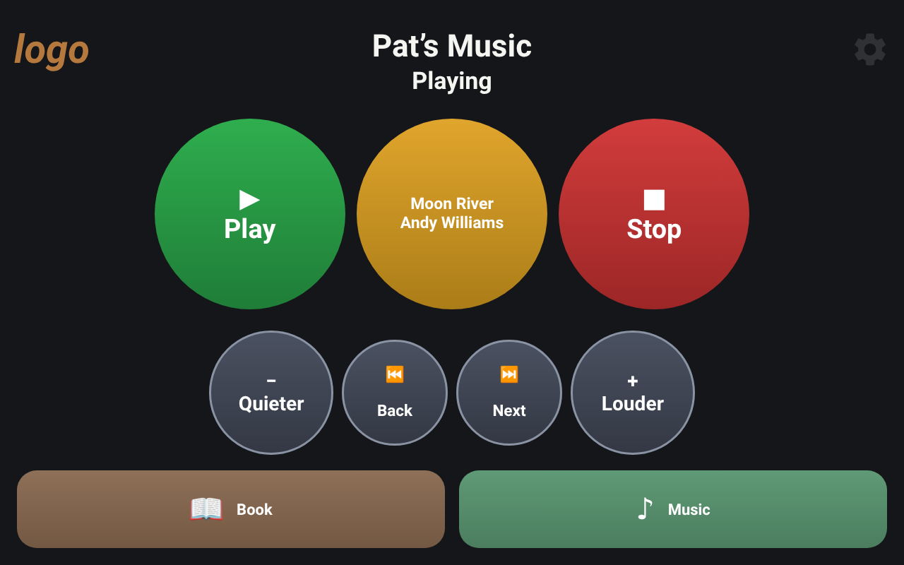
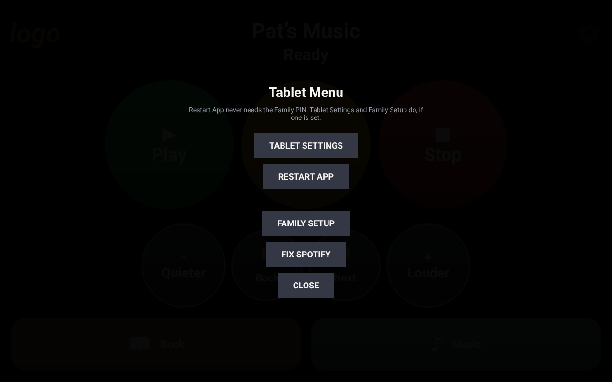

# Day-to-day guide for family, carers and staff

This page is for anyone who spends time with the person using the tablet. You don't need to know how it was set up. It is written to be printed and kept next to the tablet.

The tablet plays the person's own music and, if one was added, an audiobook. It has been set up so the person can use it on their own, with a few large buttons and nothing else.

## The buttons

| Button | What it does |
| --- | --- |
| **Music** | Starts their music. If the family set up more than one playlist, it offers a choice. |
| **Book** | Starts their audiobook. Only there if a book was added. |
| **Play** | Carries on from where it stopped. |
| **Stop** | Pauses, keeping the place. Press Play to carry on. |
| Middle circle | Shows what is playing: the song and the singer, or the book and chapter. You can't press it. |
| **Quieter** and **Louder** | Change the volume. |
| **Back** and **Next** | Go to the previous or next song or chapter. Hold Back down to go to the very start. |

Most people only ever use Play and Stop, and that is fine.

## Helping the person use it

- Show them **Play** and **Stop** first. Everything else can wait.
- If a song seems to upset them, press **Next** or **Stop**. Let the family know, so they can take it off the playlist.
- Keep the volume comfortable. It is easy to turn up a little at a time and hard to undo a sudden loud start.
- The words at the top of the screen (for example *Ready* or *Playing*) tell you what the tablet is doing. The table further down explains them.

## Please don't

- **Unplug it.** It is meant to stay on charge all the time. Old tablets often have tired batteries.
- **Take it off the wall or stand** unless you are moving it for the family.
- **Uninstall anything or change Android's settings.** That can undo the setup.
- **Use the same Spotify account on your own phone.** The music would jump to your phone.

## The setup cog

The faint cog in the top right corner opens the **Tablet Menu** when you press and hold it for about one and a half seconds. The person doesn't need it.

Staff and carers normally only need **Restart App** and **Fix Spotify**. **Family Setup** and **Tablet Settings** are for the family, and need the PIN if one is set.

## If something goes wrong

Try these in order. Most problems are fixed by step 1 or 2.

1. **Wait a minute.** After a power cut or a restart, the screen says *Warming up…* while Spotify starts. It changes to *Ready* by itself.
2. **Restart App.** Press and hold the cog, then tap **Restart App**. No PIN needed.
3. **Fix Spotify.** Press and hold the cog, tap **Fix Spotify**, then **Force stop** and **OK**. Press the tablet's Home button to come back, then press Music. Spotify starts again by itself.
4. **Restart the tablet.** Hold the power button and choose **Restart**. The app comes back by itself.
5. **Still not right?** Contact the family, using the details at the bottom of this page.

### What the words at the top mean

| Message | What it means | What to do |
| --- | --- | --- |
| *Ready* | All is well. | Press Music, Book or Play. |
| *Warming up…* | The tablet has just been switched on and Spotify is starting. | Wait about 90 seconds. It changes to *Ready* by itself. |
| *Starting Spotify… try the button again in a few seconds.* | Spotify wasn't running, so the app has woken it. Spotify's screen may flash up briefly. | Wait five seconds, then press Music or Book again. |
| *Couldn't reach Spotify - check the tablet is online.* | No internet connection. | Check the Wi-Fi is working, then press Play again. |
| *Couldn't find the tablet's Spotify device - pick it again in Family Setup.* | Spotify has forgotten which device should play. | Try Restart App. If it comes back, the family need to fix it in Family Setup. |
| *Spotify isn't connected yet.* | The Spotify login has run out. This happens about every six months. | The family need to log in again. It takes a couple of minutes. |
| Stuck on Android's normal home screen | Something took the tablet out of the app. | Press the Home button. If Android asks which app, choose **Music Player** and **Always**. Or restart the tablet. |

## Contacts

Fill this in and keep it with the tablet.

| | |
| --- | --- |
| Person's name | |
| Family contact | |
| Phone | |
| Who holds the PIN | |
| Tablet name (on the back) | |

Questions about the app itself: **dancing@7genanalytics.com**.
