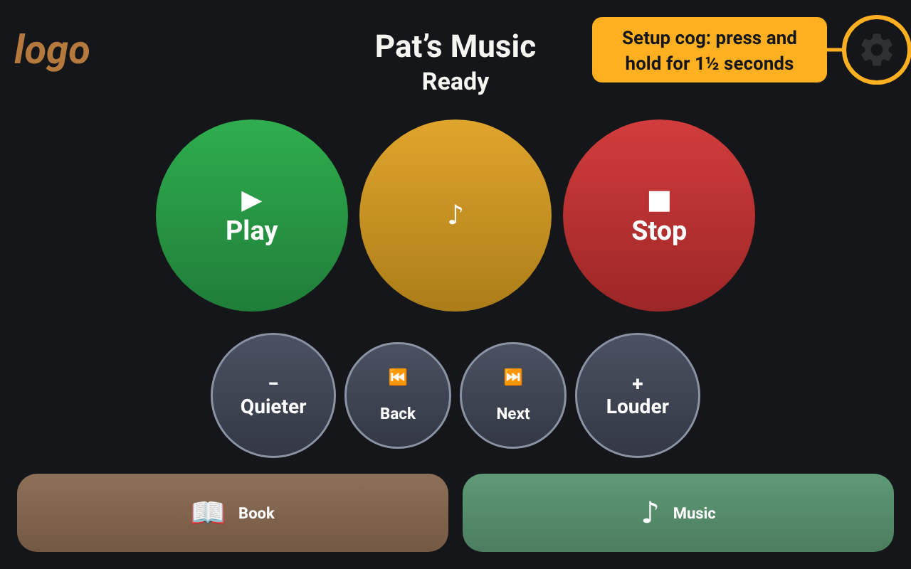
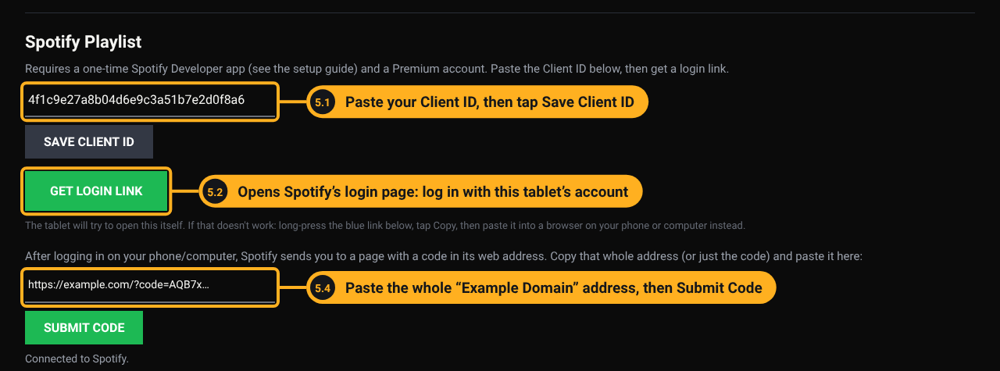
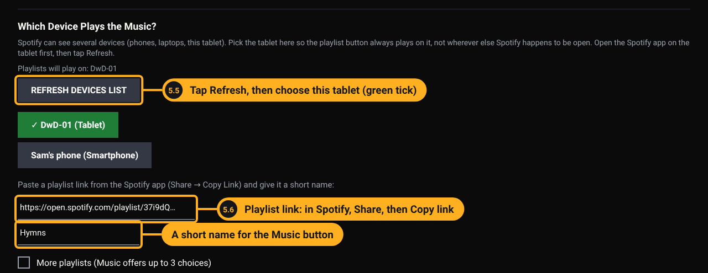
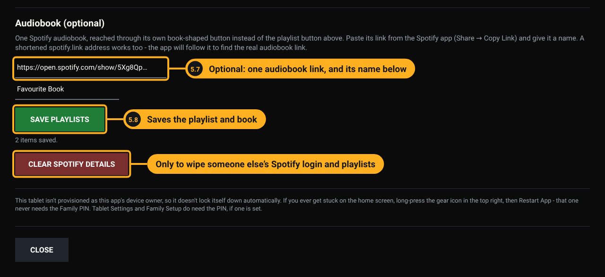
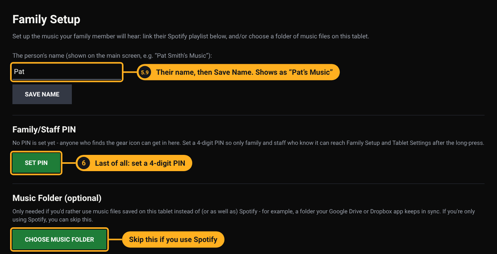

# Getting started

This guide is for a family member, friend or volunteer setting up Dancing with Dementia for someone they care about. You don't need to be technical. Allow about an hour the first time.

Dancing with Dementia turns an Android tablet into a very simple music and audiobook player: a few large buttons, nothing to get lost in, and no need for the person to find their way around Spotify or a phone. You set it up once with their music, and from then on it just plays.

*The main screen, with the tablet on its side. The faint cog in the top right corner is how you reach the setup screens: press and hold it for about one and a half seconds. The person using the tablet doesn't need it. The tablet can also stand upright, and the buttons rearrange to fit ([see it upright](images/main-portrait.png)).*

It is free, open source software (Apache 2.0 licence). It is not a medical product, and it collects no personal data: the only service it talks to is Spotify.

## What you need

- **An Android tablet.** Android 9 or newer. This is a good use for an old tablet sitting in a drawer: the app is built to be light, and it is tested and running day to day on an Android 9 tablet (a Neocore N1+). A stand and a charger it can live on are a big help.
- **A Wi-Fi connection** where the tablet will live, and the Wi-Fi name and password. Spotify streams the music over the internet, so without Wi-Fi the buttons can't play anything.
- **A Spotify Premium account for this tablet.** Premium is needed for one app to control another's playback. Use one account per tablet: a Spotify account can only play on one device at a time.
- **The person's music:** a Spotify playlist (up to three), and optionally one audiobook. If you need help choosing songs, [Playlist for Life](https://www.playlistforlife.org.uk/) has free guidance on building a personal playlist.
- **A computer** for one step (creating your Spotify developer app, step 1). A phone works too, but a bigger screen is easier.

## Choose how locked down the tablet should be

| | **Simple setup** (this guide) | **Locked-down setup** |
| --- | --- | --- |
| Who it suits | Someone at home, with family nearby | Care homes, or anyone likely to wander out of the app |
| What you need | Just the tablet | A computer with `adb`, a USB cable, and a tablet you are happy to wipe |
| What the person can do | The app fills the screen and is the tablet's home screen, but a swipe from the very edge can still show Android's bars | Nothing but the app. Bars, notifications and the lock screen are blocked |
| Guide | Carry on below | [TABLET-SETUP.md](TABLET-SETUP.md) |

You can start simple and move to locked-down later, but that later move means wiping the tablet.

> **Android 15 or newer?** Current builds can't be installed by tapping the file on these tablets; Android blocks it. Until the next build fixes this, use a computer: follow step 4 of [TABLET-SETUP.md](TABLET-SETUP.md) and add `--bypass-low-target-sdk-block` to the `adb install` command. To check the version: Settings, About tablet, Android version.

## 1. Create your own Spotify developer app (once)

Spotify only lets an app control music if it has been registered. Each family registers its own, which takes about ten minutes and is free. One registration covers up to five Spotify accounts, so one is enough for a few tablets.

1. On a computer, go to [developer.spotify.com/dashboard](https://developer.spotify.com/dashboard) and log in with the **Premium** Spotify account. Accept the developer terms if asked.
2. Click **Create app** and fill it in:
   - **App name:** anything, for example `Mum's music tablet`.
   - **App description:** anything, for example `Simple music player for a family member`.
   - **Redirect URI:** exactly `https://example.com/` (with the final slash), then click **Add**. This is a harmless placeholder page that belongs to nobody in this project; the app uses it only to collect a login code.
   - **Which API/SDKs are you planning to use:** tick **Web API**.
   - Tick to agree to the terms, then **Save**.
3. Open the app's **Settings** and copy the **Client ID** (a long string of letters and numbers). Email it to yourself, or keep it somewhere you can paste from on the tablet. You do **not** need the client secret.
4. If the tablet will use a **different** Spotify account from the one you logged in with, add it: **User Management**, then add that account's name and email address.

Things to know about Spotify's rules (as of 2026; Spotify does change them):

- The account that created the developer app must keep its **Premium** subscription. If it lapses, the tablet stops being able to play until it is renewed.
- Spotify asks for the tablet to be **logged in again about every six months**. The tablet will show *Spotify isn't connected yet.* when this happens. Repeat items 2 to 4 of step 5 below; it takes two minutes.

## 2. Install the app on the tablet

1. On the tablet, open **Chrome** and go to **github.com/7GenAnalytics/DancingwithDementia-releases/releases**.
2. Under the newest build, open **Assets** and tap the file named `DancingwithDementia-` followed by the build number and `.apk`.
3. Android warns about installing apps from outside the Play Store. This is expected. Tap **Settings**, switch on **Allow from this source**, then go back.
4. Tap **Install**. If Play Protect says it doesn't recognise the app, choose **More details**, then **Install anyway**.
5. Afterwards, switch that permission back off: Settings, Apps, Chrome, Install unknown apps.
6. Install **Spotify** from the Play Store and log in with this tablet's Premium account. Play any song for a few seconds, then stop it. This registers the tablet with Spotify.
7. Press the tablet's **Home** button. When Android asks which app to use, choose **Music Player** and **Always**. *(The app is listed as "Music Player" on current builds; the next build renames it Dancing with Dementia.)*

## 3. Put the tablet in its place

Where and how the tablet sits matters as much as the app. The aim is a tablet that is always on, always charged, always in the same spot, and can't be knocked over or carried off.

- **Keep it plugged in.** Old tablets often have tired batteries that only last an hour or two. Leave the tablet connected to a wall socket through its USB charger, permanently. It then never runs flat, and the app restarts by itself after a power cut.
- **Fix it to the wall or a stable surface.** Strong double-sided sticky Velcro pads on the back of the tablet work well: it stays put at a comfortable height, but you can lift it off for setup or updates. A tablet stand on a table is the alternative if you can't fix it to a wall.
- **Choose the spot carefully.** Within easy reach of the chair or bed the person uses most, at seated eye level, away from direct sunlight (glare makes the screen hard to see), and where the charging cable can't be tripped over or pulled. Tuck or clip the cable along the wall.
- **Check it within reach of the Wi-Fi.** Play some music there before you fix it in place. A weak signal makes the music stop and start.
- **Battery safety.** A very old battery left on charge for a long time can occasionally swell. Every few weeks, look at the tablet: if the screen starts lifting or the back bulges, unplug it and stop using it. Use a decent charger, ideally the one that came with the tablet, and don't cover the tablet.

## 4. Make the tablet calmer

A few Android settings make a big difference. Menu names vary between tablets; if you can't find one, use the search bar at the top of Settings.

- **Screen lock: None.** A PIN or swipe would stand between the person and their music.
- **Screen timeout: the longest option.** A dark screen looks broken. If the tablet lives on its charger, also switch on **Stay awake**, which keeps the screen on while charging. It is in Developer options, which is hidden until you go to Settings, About tablet and tap **Build number** seven times.
- **Touch sounds, keyboard sounds and vibration: off.** Unexplained beeps can be distressing.
- **Do Not Disturb: on.** Music still plays; pop-ups stay away.
- **Battery for Spotify and Music Player: Unrestricted** (Settings, Apps, the app, Battery). Otherwise Android may close Spotify and the buttons stop working.
- **Date and time: automatic.** A wrong clock quietly breaks the Spotify login.

The full checklist, with the reason for each setting, is in step 7 of [TABLET-SETUP.md](TABLET-SETUP.md#7-tablet-settings-checklist).

## 5. Family Setup: connect Spotify and add the music

To open Family Setup, **press and hold the faint gear icon** in the top right corner for about a second and a half. The Tablet Menu opens; tap **Family Setup**.

Family Setup is one long page: scroll down through it. The numbers on the pictures below match these steps (5.1 is step 5, item 1). The name box and the PIN are at the top of the page, but leave them until the end.

1. **Spotify Playlist section.** Paste your Client ID from step 1 into **Spotify Client ID** and tap **Save Client ID**. It says *Client ID saved.*
2. Tap **Get Login Link**. The tablet tries to open Spotify's login page.
   - If it doesn't open, long-press the blue link, tap **Copy**, and paste it into a browser on your phone or computer instead. Older tablets often need this.
3. Log in with **this tablet's** Spotify account and tap **Agree**. You land on a plain page titled "Example Domain". That is expected.
4. Copy the **whole web address** of that page, paste it into **Paste code or web address here**, and tap **Submit Code**. It should say *Connected to Spotify.*

5. **Which Device Plays the Music?** Tap **Refresh Devices List** and choose this tablet; it turns green with a tick. If it isn't listed, play a song in the Spotify app again, then refresh. Choosing the tablet here stops the music playing on someone's phone by mistake.
6. **Playlist.** In the Spotify app, open the playlist, tap the three dots, then **Share**, **Copy link**. Paste it into **Playlist link** and give the button a short name, such as *Hymns* or *Dancing*.
   - For up to three playlists, tick **More playlists** and fill in the other two the same way. The Music button will then offer a choice.

7. **Audiobook (optional).** Copy the book's link the same way, paste it into **Audiobook link** and give it a name. Leave it empty and the Book button doesn't appear.
8. Tap **Save Playlists**. It says how many items were saved, or explains what is wrong with a link.

9. **Name.** Scroll back to the top, type the person's name and tap **Save Name**. The main screen then reads, for example, *Pat's Music*.

You can skip **Music Folder**: it is only for music files saved on the tablet instead of Spotify. Leave **Clear Spotify details** alone unless the tablet has someone else's Spotify login or playlists on it.

## 6. Test, then set the PIN last

1. Close Family Setup and try every button: **Music** (and each choice, if there are several), **Book**, **Play**, **Stop**, **Back**, **Next**, **Louder**, **Quieter**.
2. **Last of all**, open Family Setup again and tap **Set PIN**. Enter a 4-digit PIN twice. Without a PIN, anyone who finds the gear can change the setup. Write it down somewhere safe and share it only with people who need it.

The PIN is a gentle lock to stop accidental changes, not strong security: it is stored on the tablet as plain text.

That's it. The tablet is ready.

## Day to day

- **Play** carries on from where the music stopped. **Stop** pauses it in place. In practice, most people only ever use these two.
- **Restart App** in the Tablet Menu never needs the PIN. It is the guaranteed way back if anything looks wrong.
- **After a power cut or restart**, the app comes back by itself. Spotify takes a minute or so to wake up.

### What the messages mean

These are the words the app shows under the name at the top of the screen.

| Message | What it means | What to do |
| --- | --- | --- |
| *Warming up…* | The tablet has just been switched on and Spotify is starting. | Wait about 90 seconds. It changes to *Ready* by itself. |
| *Starting Spotify… try the button again in a few seconds.* | Spotify wasn't running, so the app has woken it. Spotify's screen may flash up briefly. | Wait five seconds, then tap Music or Book again. |
| *Couldn't find the tablet's Spotify device - pick it again in Family Setup.* | Spotify has forgotten which device should play. | Open the Spotify app once, then Family Setup, **Refresh Devices List**, and choose the tablet. |
| *Couldn't reach Spotify - check the tablet is online.* | No internet connection. | Check Wi-Fi is on and connected, then tap Play again. |
| *Spotify isn't connected yet.* | The Spotify login has expired (about every six months) or was never done. | Repeat steps 2 to 4 of Family Setup above. |
| Spotify is stuck, or the buttons still do nothing after Restart App | Spotify itself has got stuck. It is not a fault in this app. | Tablet Menu, **Fix Spotify**, then **Force stop** and **OK**. Press Home to come back, then press Music. Spotify starts again by itself. |
| Stuck on Android's normal home screen | Something took the tablet out of the app. | Press Home. If Android asks, choose Music Player and Always. Or restart the tablet. |

### Updating

New builds appear on the [releases page](https://github.com/7GenAnalytics/DancingwithDementia-releases/releases). Install the new file exactly as in step 2. It goes over the top and keeps the name, PIN, playlists and book.

**Never uninstall to update.** Uninstalling wipes Family Setup.

## Questions, problems and ideas

Email **dancing@7genanalytics.com**, or open an issue on this repository. If you change or improve the app, we would love to hear about it.
